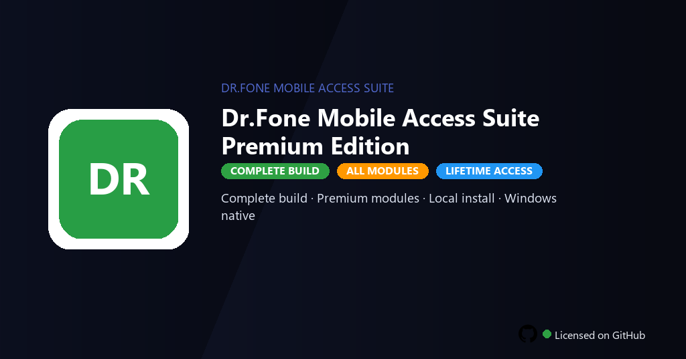

# Dr.Fone Mobile Unlock Suite: Premium Edition for Windows 11

    

---

Dr.Fone-Mobile-Unlock-Suite-Premium-Edition is a Windows desktop application for unlocking Android and iPhone devices, covering screen locks, FRP bypass, and carrier SIM restrictions from a single interface. The suite combines premium modules and pro-grade tools for both mobile platforms, enabling technicians and advanced users to resolve locked-device scenarios without recurring service fees. Built natively for 64-bit Windows 10 and 11, it runs as a local installation with offline capability after initial setup. The toolkit ships with the complete set of unlock utilities, presets, and workflow components required for daily professional use.

## Features

- **Cross-platform screen unlock** — Removes lock screen passcodes, PINs, patterns, and passwords from supported Android and iPhone devices through a guided Windows workflow.
- **Android FRP bypass** — Clears Factory Reset Protection on compatible Samsung and other Android devices so a reset handset can be provisioned again without the prior Google account.
- **iPhone screen lock removal** — Handles locked, disabled, or passcode-blocked iOS devices, including scenarios where the device is stuck on the lock screen after multiple failed attempts.
- **Carrier SIM unlock assistance** — Supports removing carrier restrictions on eligible devices so they can accept SIM cards from other networks.
- **Unified device dashboard** — Detects connected phones over USB, reports model, firmware, and lock state, and routes each device to the appropriate unlock module from a single interface.
- **Guided unlock wizards** — Step-by-step flows validate device compatibility before execution, warn about data-loss implications, and confirm each stage of the unlock process.
- **Firmware and driver handling** — Bundles the drivers and device profiles needed for reliable detection, with automatic matching of firmware packages to the connected handset.
- **Local, offline operation** — Core unlock routines run on the Windows machine after setup; no persistent network dependency is required for standard workflows.
- **Windows-native desktop build** — A 64-bit application optimized for Windows 10 and 11, with a native installer and standard system integration.
- **Activity logging** — Records each session's device details, selected module, and outcome for audit and troubleshooting purposes.
- **Premium edition modules** — All pro-level unlock tools, FRP utilities, and SIM workflows are enabled in this build without per-feature restrictions.

## How It Works

The suite operates through a staged device pipeline that begins with detection and handshake negotiation over the Windows USB stack. Once a device is recognized, the application enumerates the connected handset's boot mode, firmware metadata, and lock state, then maps that profile against its bundled device database to select the appropriate unlock path. Android workflows branch into screen-lock removal, FRP bypass, and carrier SIM restriction handling, each executing as an isolated module so a failure in one path does not disrupt device communication. iPhone workflows follow a separate sequence that prepares the device in recovery or DFU context, verifies the iOS build signature, and applies the corresponding screen-unlock routine. All operations run locally under a single desktop process, with no background services required after initialization. Progress is reported per stage in the interface, and each completed step writes a rollback checkpoint so a device can be returned to its prior state if a procedure is interrupted. The premium edition exposes the full module set, including the advanced FRP and SIM-lock routines that are gated in lower tiers.

## Compatibility & Requirements

**Operating System:** Windows 10 and Windows 11, 64-bit editions only. The suite is built and tested exclusively for the Windows desktop environment and does not support 32-bit, macOS, or Linux hosts.

**Hardware Baseline:** A minimum of 8 GB RAM is required for stable operation of the unlock and FRP modules, with 4 GB of free disk space needed for the application files and temporary device working data. Additional headroom is recommended when processing multiple devices or handling larger firmware payloads.

**Device Coverage:** Android devices are supported for screen unlock, FRP bypass, and carrier SIM lock removal across major manufacturers and chipset families. iPhone support covers screen passcode unlock workflows as implemented in the premium module set. Actual per-model compatibility depends on the device firmware version and chipset, and certain models or OS builds may fall outside the supported matrix.

**Connectivity & Drivers:** A working USB connection between the host machine and the target device is mandatory. Original manufacturer USB drivers must be installed and recognized by Windows before initiating any unlock or FRP operation. Standard Windows driver signing applies; unsigned or mismatched drivers will block device detection.

**Runtime Environment:** No external runtime, package manager, or command-line dependency is required. The suite operates as a self-contained desktop application and functions fully offline once installed, with no cloud dependency for core unlock operations.

**Permissions:** Administrative privileges on the Windows host are required for driver interaction and low-level device communication. Standard Windows security prompts may appear during first launch and device handshake.

**Storage & Session Notes:** Unlock and FRP procedures involve temporary local data written to the host disk; ensure the free-space requirement is met and that the session is not interrupted mid-operation. Firmware-version-specific support is documented per module, and users should verify device applicability before proceeding.

## FAQ

**What platforms and device types does the suite support?**
The suite is a Windows-native desktop application built for Windows 10 and 11, 64-bit. It provides unlock and bypass tooling for both Android and iPhone devices, covering screen locks, FRP (Factory Reset Protection), and carrier SIM locks from a single interface.

**How does the unlock process work?**
The suite connects to a device over USB, identifies the model and lock state, and applies the appropriate unlock routine for that device class. Screen unlock, FRP bypass, and SIM lock removal are handled as distinct modules so you can target the exact lock condition present on the device.

**Which lock types are covered?**
Three categories are supported: device screen locks on Android and iPhone, FRP locks on Android devices, and carrier SIM locks. Each module is selected independently depending on the lock state detected.

**What does the Premium Edition enable compared to a standard build?**
The Premium Edition exposes the full module set — all unlock routines, FRP handling, and SIM unlock tools — without per-feature restrictions. It is the complete build of the suite rather than a limited subset.

**Does the software require an internet connection?**
The suite runs locally on Windows. After the initial setup is complete, unlock operations are performed on the machine without depending on external services for the core workflows.

**What are the system requirements?**
Windows 10 or 11, 64-bit architecture, a minimum of 8 GB RAM, and at least 4 GB of free disk space. A working USB connection to the target device is required for any unlock operation.

**Is the tool compatible with both Android and iPhone in the same install?**
Yes. A single installation covers both platforms, and the correct module is selected based on the connected device. You do not need separate builds for Android and iOS.

**What should I do if a device is not detected?**
Confirm the USB cable and port are functional, verify the device is powered on, and check that the required device drivers are present on the Windows host. Reconnecting the device and re-running detection typically resolves enumeration issues.

**Can the suite be used offline after setup?**
The core unlock workflows operate locally. Once the application and its modules are in place, routine operations do not require a persistent network connection.

**How are updates delivered?**
Updated builds of the suite are published as new releases. Replacing the existing installation with the latest package keeps the module set current.

## Disclaimer

This build is provided for legitimate device administration, personal recovery, and authorized repair scenarios only. Dr.Fone-Mobile-Unlock-Suite-Premium-Edition performs low-level operations on mobile firmware and security partitions, and those capabilities are powerful by design.

By using this software you acknowledge and agree that:

- **Authorization is required.** You must own the device being unlocked or hold explicit, documented permission from its owner to perform screen, FRP, or carrier SIM unlock procedures. Operating on devices without authorization may violate applicable laws and regulations in your jurisdiction.
- **Technical results vary.** Unlock behavior depends on device model, chipset, firmware version, bootloader state, and OEM security patches. Successful unlocking of one device does not guarantee identical results on another, even within the same product line.
- **Data loss is possible.** Screen and FRP unlock operations frequently involve factory resets or partition-level writes. Back up any recoverable data before proceeding. The suite does not guarantee preservation of user data, and some procedures will irreversibly erase it.
- **Carrier and account locks are governed by third parties.** Carrier SIM locks, iCloud activation, Google account ties, and similar restrictions are enforced by external entities. This software does not grant legal authority to circumvent contractual or account obligations, and doing so may breach service agreements.
- **No liability is accepted.** This software is provided "as is" without warranty of any kind, express or implied, including fitness for a particular purpose. The authors and contributors are not responsible for bricked devices, voided warranties, lost data, service disruption, or any direct or indirect damages arising from use or misuse of the tool.
- **Compliance is your responsibility.** You are solely responsible for ensuring your use complies with local laws, device manufacturer terms, and carrier policies. If you are uncertain whether a given operation is permitted, do not proceed.

Use this suite only where you have a clear legal and ethical basis to unlock the device in question.

## License

This build is distributed as a self-contained desktop package for Windows 10 and 11 (64-bit). It bundles the complete mobile-unlock toolchain — Android screen unlock, iPhone passcode removal, FRP bypass, and carrier SIM unlock modules — into a single installable suite. No external runtime, account, or online license check is required after the initial setup; the suite operates fully offline once deployed.

The suite is provided as-is for personal device recovery and repair workflows. Redistribution, resale, or repackaging of the bundled components under a different name is not permitted. The included modules are covered by the project's own usage terms, which apply in addition to any upstream component licenses shipped in the installer package.

License grants are non-transferable and tied to the installed build. Because the suite is feature-complete at install time, there is no activation key, trial timer, or upgrade prompt — the Premium, Pro, and Full modules are all present in the package. Updates, if any, are delivered as full replacement packages rather than incremental patches, so you may keep or replace the installed version at your discretion.

The bundled binaries are compiled for Windows x64 only. Decompilation, reverse engineering, or extraction of the embedded modules for use outside the installed suite is prohibited. The party providing this package disclaims liability for any device damage, data loss, or legal consequence arising from misuse of the unlock functionality; you are responsible for confirming that you own or are authorized to service any device you use the suite on.

No warranty — express or implied, including merchantability or fitness for a particular purpose — is offered. By installing or running the suite, you accept these terms. If you do not accept them, remove the installed files from your system.

